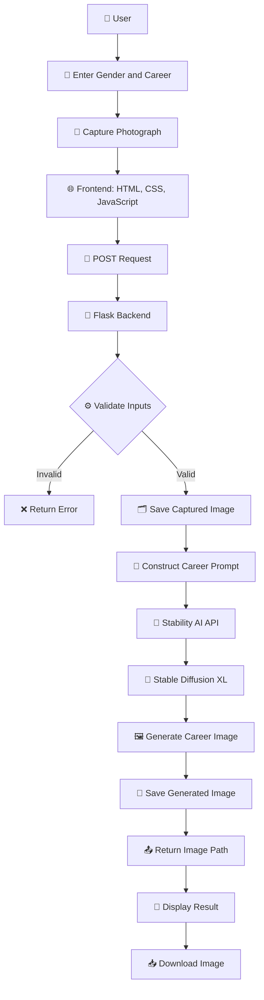

# 🚀 Career Vision Generator | AI-Powered Career Visualisation

<p align="center">
  
  
  
  
  
</p>

## 🌟 Project Overview

**Career Vision Generator** is an AI-powered web application designed to transform career aspirations into personalised professional visualisations using generative artificial intelligence.

The application allows users to select their gender, describe their desired profession or career passion, and capture a live photograph through their device camera. Based on the submitted career information, the system constructs an AI image-generation prompt and uses the Stability AI API with Stable Diffusion XL to generate a professional career-themed portrait.

The project explores how artificial intelligence, generative image models, computer vision-related interfaces, and full-stack web development can be combined to create an interactive and engaging career visualisation experience.

🎓 **Academic Project:** ISMT College – Expo 2.0  
🎤 **Participation:** Project Presenter  
🧠 **Domain:** Artificial Intelligence and Generative AI  
🌐 **Application Type:** AI-Powered Web Application

## 🎯 Project Objectives

- 🧠 Explore practical applications of generative artificial intelligence.
- 🎨 Develop an AI-powered career visualisation platform.
- 👤 Create personalised professional visualisations based on user inputs.
- 📸 Implement real-time camera access and photograph capture.
- ⚙️ Integrate third-party AI image-generation services.
- 🌐 Develop an interactive web application using frontend and backend technologies.
- 🔗 Establish communication between the frontend, backend, and external AI services.
- 🚀 Demonstrate the practical potential of AI in personal career exploration.

## 💡 Problem Statement

People often imagine their future careers but may find it difficult to visualise themselves in their desired professional roles.

Traditional career exploration tools primarily provide written descriptions, career information, or aptitude assessments.

This project explores a more visual and interactive approach by using generative AI to create professional career-themed imagery based on user-provided information.

## ✨ Key Features

### 👤 Personalised User Input
- Select gender.
- Enter a desired profession or career passion.
- Provide information for personalised visual generation.

### 📸 Live Camera Integration
- Access the device camera through the browser.
- Capture photographs in real time.
- Preview captured images.
- Retake photographs when necessary.

### 🧠 AI-Powered Image Generation
- Construct profession-specific image prompts.
- Integrate the Stability AI API.
- Generate professional career-themed portraits using Stable Diffusion XL.
- Configure image dimensions and generation parameters.

### 🌐 Interactive Web Interface
- Responsive interface using Bootstrap.
- Interactive user input forms.
- Loading animation during image generation.
- Generated image preview.

### 📥 Image Management
- View generated career visualisations.
- Download generated images.
- Reset the application for another generation.

## 🛠️ Technology Stack

| Technology | Purpose |
|---|---|
| 🐍 Python | Backend programming |
| 🌶️ Flask | Web application framework |
| 🎨 Stable Diffusion XL | AI image generation |
| 🔗 Stability AI API | External AI integration |
| 🌐 HTML5 | Frontend structure |
| 🎨 CSS3 | Interface styling |
| ⚡ JavaScript | Frontend interactions |
| 📱 Bootstrap 5.3 | Responsive interface |
| 📷 Web Media API | Live camera access |
| 🖼️ HTML Canvas | Photograph capture |
| 🔄 Flask-CORS | Cross-origin resource sharing |
| 📡 Requests | API communication |
| 🔐 Base64 | Image data encoding and decoding |
| 🗂️ GitHub | Source code management |

## 🏗️ System Architecture

The application follows a frontend-backend architecture with external AI service integration.

### 🔄 Application Workflow

1. 👤 User enters gender and career information.
2. 📸 User captures a photograph using the device camera.
3. 📤 Frontend transmits the information to the Flask backend.
4. ⚙️ Backend validates the submitted information.
5. 🗂️ Captured photograph is saved to the upload directory.
6. 🧠 Backend constructs a professional image-generation prompt.
7. 🔗 Prompt is submitted to the Stability AI API.
8. 🎨 Stable Diffusion XL generates the career-themed image.
9. 💾 Generated image is saved to the application directory.
10. 🖼️ Generated image is displayed to the user.
11. 📥 User can download the generated image.

### 📊 Architecture Diagram



## ⚙️ Implementation Details

### 🐍 Backend Development

The backend was implemented using Python and Flask.

Major responsibilities include:

- Handling incoming HTTP requests.
- Receiving and validating user inputs.
- Processing Base64-encoded image data.
- Saving uploaded photographs.
- Constructing AI image-generation prompts.
- Communicating with the Stability AI API.
- Processing generated image responses.
- Returning JSON responses to the frontend.

### 🎨 AI Image Generation

The project integrates Stability AI's Stable Diffusion XL model.

**Current generation configuration:**

| Parameter | Configuration |
|---|---|
| AI Model | Stable Diffusion XL 1.0 |
| Image Width | 1024 pixels |
| Image Height | 1024 pixels |
| Generation Steps | 30 |
| CFG Scale | 7 |
| Number of Samples | 1 |
| Output Format | PNG |

The prompt is constructed using the selected gender and career passion to generate a professional-themed portrait.

### 🌐 Frontend Development

The frontend was developed using HTML, CSS, JavaScript, and Bootstrap.

Its main responsibilities include:

- Collecting user information.
- Accessing the device camera.
- Capturing and previewing photographs.
- Sending information to the backend.
- Displaying loading animations.
- Presenting generated images.
- Providing download and reset options.

## 📁 Project Structure

```text
Career-Vision-Generator/
│
├── 📂 static/
│   ├── 📂 uploads/
│   │   └── Captured photographs
│   │
│   └── 📂 generated/
│       └── AI-generated images
│
├── 📂 templates/
│   └── 📄 index.html
│
├── 🐍 Career_Vision_Generator.py
├── 📊 flowchart.mermaid
└── 📘 README.md
```

*The uploads and generated directories are created automatically by the application when it runs.*

## 🚀 Installation and Setup

### 1️⃣ Clone the Repository

```bash
git clone https://github.com/roshanksah/Career-Vision-Generator.git
```

### 2️⃣ Navigate to the Project Directory

```bash
cd Career-Vision-Generator
```

### 3️⃣ Create a Virtual Environment

```bash
python -m venv venv
```

Activate the environment:

**Windows:**
```bash
venv\Scripts\activate
```

**Linux / macOS:**
```bash
source venv/bin/activate
```

### 4️⃣ Install Dependencies

```bash
pip install flask flask-cors requests
```

### 5️⃣ Configure API Credentials

Obtain a Stability AI API key and configure it through an environment variable.

Do not publish private API credentials in your repository.

### 6️⃣ Run the Application

```bash
python Career_Vision_Generator.py
```

Open the application in your browser:

```text
http://127.0.0.1:5000
```

📌 Camera access generally requires localhost or a secure HTTPS connection and browser permission.

## 📈 Project Results and Outcomes

The project demonstrates the integration of generative AI into an interactive web-based career visualisation application.

### 🏆 Key Technical Outcomes

- 🌐 Developed a working frontend and backend application architecture.
- 📸 Implemented browser-based live camera access and photograph capture.
- 👤 Developed an interactive interface for collecting career-related user information.
- 🐍 Implemented backend processing using Python and Flask.
- 🔗 Integrated an external AI image-generation API.
- 🎨 Implemented Stable Diffusion XL-based professional image generation.
- 🖼️ Developed a generated-image presentation interface.
- 📥 Implemented image download and reset functionality.

### 🌟 Overall Project Outcome

The project demonstrates how generative artificial intelligence can be integrated into a practical web application to create interactive and personalised career-themed visual experiences.

It provided practical experience in API integration, backend development, frontend interaction, image processing, and AI-powered application development.

*Note: These are implementation outcomes, not measured performance benchmarks. The repository does not currently provide verified generation-time statistics, user-study results, or image-quality evaluation scores.*

## 🎤 ISMT College – Expo 2.0

### 🏅 Project Presentation

This project was presented at **ISMT College Expo 2.0**, where I showcased the concept and technical implementation of an AI-powered career visualisation application.

As the project presenter, I had the opportunity to demonstrate how generative AI and modern web technologies can be combined to create an interactive application.

### 🎯 Presentation Highlights

- 🧠 Explained the concept and objectives of the project.
- 🌐 Presented the web application architecture.
- 📸 Demonstrated the live camera capture functionality.
- 🎨 Showcased the AI-powered image-generation workflow.
- 🔗 Explained the integration of Python, Flask, and Stability AI.
- 💬 Communicated the project's potential applications and future improvements.

### 💡 Skills Demonstrated

- 🎤 Technical presentation and communication.
- 🧩 Problem-solving and application development.
- 🤖 Understanding of generative AI integration.
- 🌐 Full-stack web development.
- 🔗 API integration and system architecture.
- 👥 Explaining technical concepts to an audience.

## 🚀 Future Improvements

There are several opportunities to extend this project into a more advanced AI-powered career exploration platform.

### 🧬 Advanced AI Personalisation
- Implement image-to-image generation to preserve the user's facial appearance.
- Explore more advanced personalised image-generation techniques.
- Improve prompt engineering for profession-specific outputs.

### 📝 AI-Generated Career Descriptions
- Integrate a language model to generate personalised career summaries.
- Provide descriptions of professional roles and potential career pathways.
- Generate personalised motivational messages.

### 🌐 Application Development
- Develop user authentication and profile management.
- Introduce a history of previously generated career visions.
- Add multiple image-generation styles.
- Improve responsive design and user experience.

### ☁️ Deployment and Scalability
- Deploy the application to a cloud platform.
- Introduce secure API-key management.
- Improve error handling and request processing.
- Optimise image storage and retrieval.

## ⚠️ Limitations and Disclaimer

This application generates AI-created professional visualisations based on user-provided career information.

Generated images are illustrative and represent hypothetical career aspirations. They do not predict actual career outcomes, professional achievements, qualifications, or future employment opportunities.

The current implementation does not use the captured photograph as an image-generation reference, despite collecting and storing it. Personalised face-preserving image generation is a potential future enhancement.

## 👨‍💻 Author

**Roshan Kumar Sah**

🎓 BSc (Hons) Computer Systems Engineering

🏫 ISMT College | University of Sunderland

🎤 Presenter – ISMT College Expo 2.0

### 🔗 Connect With Me

- 🐙 GitHub: [github.com/roshanksah](https://github.com/roshanksah)
- 💻 Project Repository: [Career Vision Generator](https://github.com/roshanksah/Career-Vision-Generator)

### 💡 Areas of Interest

Artificial Intelligence | Generative AI | Machine Learning | Full-Stack Development | Computer Vision | Edge Computing | Internet of Things (IoT)

---

<p align="center">
  <h3>🌟 Imagine Your Future. Visualise Your Career.</h3>
  <b>Exploring the Creative Potential of Artificial Intelligence.</b>
  <br/>
  🚀 Built as an academic project and presented at ISMT College Expo 2.0.
</p>
